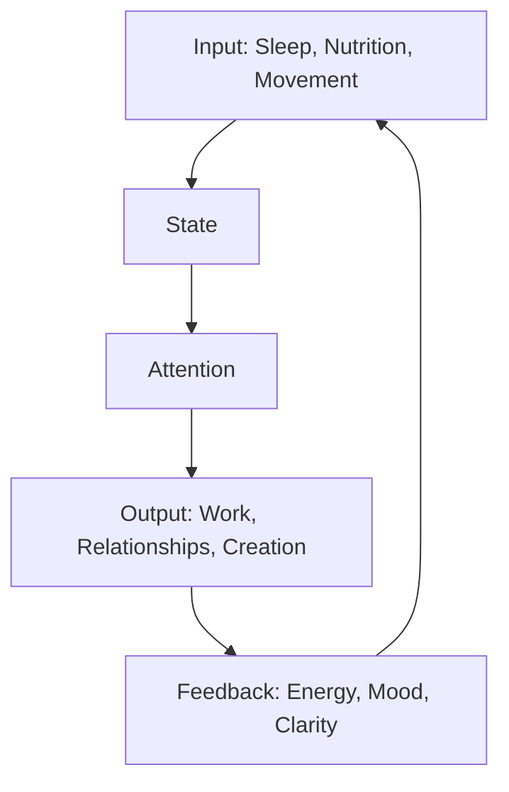

## Problem

High output without a model leads to burnout, reactive decision-making, and misaligned effort. I needed a system that treats the self as an operating environment — not a motivation problem.

## Observation

- Energy fluctuates in cycles; willpower does not scale.
- Context switching has compound costs.
- Recovery is infrastructure, not indulgence.
- Identity shapes behavior more reliably than goals.

## Model

The Human Operating Model (HOM) treats cognition, emotion, and physiology as interconnected subsystems. Performance emerges from **state management**, not time management.

<Callout type="note">
State precedes strategy. A clear plan executed in a depleted state produces poor outcomes at high cost.
</Callout>

## Components

| Component | Function |
|-----------|----------|
| Energy Ledger | Track sleep, movement, and cognitive load |
| Attention Budget | Daily deep-work blocks with hard boundaries |
| Recovery Protocol | Non-negotiable restoration rituals |
| Identity Anchors | Principles that survive mood variance |

## Rules

1. **No optimization without measurement** — track state before adding habits.
2. **Protect the first deep block** — mornings are for high-leverage work.
3. **Single-task default** — parallelization is for machines, not minds.
4. **Weekly review** — adjust inputs based on feedback loops.

## Feedback Loops

**Positive:** Better sleep → sharper attention → higher quality output → reduced anxiety → better sleep.

**Negative:** Poor recovery → reactive work → context switching → shallow output → guilt → worse recovery.

## Applications

- Engineering sprint planning aligned with energy cycles
- Saying no to low-leverage commitments
- Designing work environments that reduce cognitive friction

## Limitations

- Does not replace clinical support for mental health conditions
- Cultural and economic constraints affect feasibility of recovery protocols
- Over-systematizing can become another form of avoidance

## Future Evolution

- Integrate biometric signals (HRV, sleep stages)
- Formalize decision delegation when state is below threshold
- Version 3.0: team-level operating model extension

## Related Systems

- [Decision Engine](/systems/decision-engine)
- [Wealth System](/systems/wealth-system)

## Related Projects

Implementations of HOM principles appear in how I structure CI/CD review cycles and on-call rotations — sustainable systems require sustainable operators.
