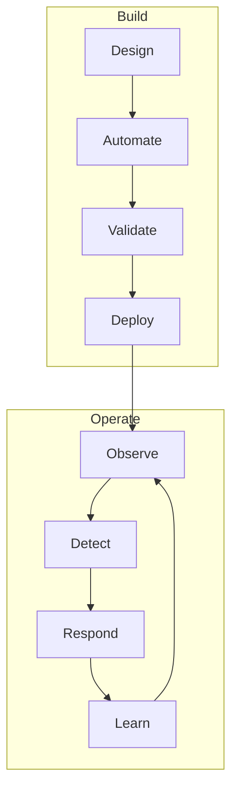

## Problem

Infrastructure without an operating model becomes tribal knowledge, hero-driven incident response, and fragile automation.

## Observation

- You cannot operate what you cannot observe.
- Failure is normal; design for detection and recovery.
- Change causes more outages than hardware.
- Documentation is a runtime dependency.

## Model

## Components

- **Golden Signals** — latency, traffic, errors, saturation
- **Runbooks** — procedural knowledge codified
- **Blast Radius Limits** — canary, staged rollout, feature flags
- **Postmortems** — blameless, action-oriented

## Rules

1. No deploy without rollback path
2. Alerts must be actionable or they get muted
3. Automate the second occurrence, not the first
4. Capacity planning is a continuous process

## Feedback Loops

**Positive:** Better observability → faster MTTR → fewer repeat incidents → more time for automation.

**Negative:** Alert fatigue → ignored signals → prolonged outages → reactive firefighting → more change risk.

## Applications

- Kubernetes cluster operations
- Database HA (PostgreSQL, Redis)
- CI/CD pipeline design

## Limitations

- Small teams may over-engineer early
- Vendor-managed services shift but don't eliminate operational burden

## Future Evolution

- SLO-driven error budgets across all services
- Chaos engineering as standard practice

## Related Systems

- [Decision Engine](/systems/decision-engine)

## Related Projects

- [Scalable Mail Infrastructure](/projects/smtp-system)
