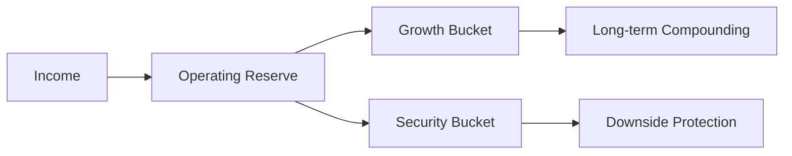

## Problem

Money without a system becomes emotional, reactive, and opaque. I needed a model that separates **strategy** from **market noise**.

## Observation

- Liquidity is optionality.
- Risk is position size, not prediction accuracy.
- Cash flow clarity reduces decision fatigue.
- Compounding requires time and consistency, not heroics.

## Model

The Wealth System is a layered capital architecture:

<Callout type="warning">
Never invest capital you cannot afford to lose from the security bucket. Growth and security serve different functions.
</Callout>

## Components

1. **Operating Reserve** — 6–12 months of essential expenses
2. **Security Bucket** — low-volatility, high-liquidity assets
3. **Growth Bucket** — diversified long-term positions
4. **Review Cadence** — monthly cash flow, quarterly allocation

## Rules

- Automate savings before discretionary spending
- Rebalance on schedule, not on headlines
- Document every major allocation decision with rationale
- No leverage without explicit risk budget

## Feedback Loops

**Positive:** Automated savings → growing reserves → reduced anxiety → better decisions → improved allocation.

**Negative:** Lifestyle inflation → thin reserves → reactive selling → losses → fear-driven decisions.

## Applications

- Personal finance automation
- Evaluating freelance vs. employment tradeoffs
- Infrastructure cost optimization parallels (spend vs. invest)

## Limitations

- Not financial advice; personal operating model only
- Macro shocks can invalidate assumptions
- Tax and legal complexity vary by jurisdiction

## Future Evolution

- Integrate scenario modeling for income volatility
- Link to Decision Engine for major purchase thresholds

## Related Systems

- [Human Operating Model](/systems/human-operating-model)
- [Decision Engine](/systems/decision-engine)

## Related Projects

Financial discipline mirrors infrastructure budgeting — predictable burn, reserved capacity, measured scaling.
